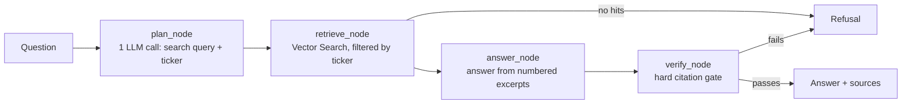

# PolicyPilot

A governed, citation-first Q&A copilot over SEC Form 10-K filings, running as a LangGraph agent on Azure Databricks.

Ask "What supply chain risks does Apple disclose?" and PolicyPilot searches Apple's latest 10-K, writes an answer from the filing, and attaches a numbered citation to every claim. If the filing doesn't support an answer, it refuses instead of guessing.

| Layer | What it uses |
|---|---|
| Agent | LangGraph: `plan_node → retrieve_node → answer_node → verify_node` |
| Data | Unity Catalog Delta table `policypilot_dev.filings.chunks` with Change Data Feed |
| Retrieval | Databricks Vector Search, Delta-Sync index with self-managed `all-MiniLM-L6-v2` embeddings |
| LLM | Groq `openai/gpt-oss-120b` behind a Unity AI Gateway external-model endpoint |
| Guardrails | Gateway PII + safety filters, custom off-topic and investment-advice guardrails, and a hard citation gate in code |
| UI | Streamlit on Databricks Apps, running as the app's auto-created service principal |
| CI/CD | GitHub Actions with Azure OIDC (no stored credentials), Databricks Asset Bundles, MLflow GenAI evaluation |

## How the agent works



`verify_node` is pure Python (`agent/citations.py`). An answer only reaches the user if every claim carries a `[n]` marker, every marker points at a passage that was actually retrieved, and every figure in a claim appears in the passage it cites. Anything else becomes a refusal, with the reasons shown under "How this answer was produced".

The graph is identical everywhere. `PP_ENV` only swaps the backends:

| `PP_ENV` | LLMClient | VectorStore |
|---|---|---|
| `databricks` | Unity AI Gateway endpoint via the workspace's OpenAI-compatible API | Databricks Vector Search |
| `local` | Groq API directly (`GROQ_API_KEY`) | In-memory index from `data/local_chunks.jsonl` |

## Repository layout

```
agent/            the LangGraph agent (graph, nodes, prompts, citation gate, backends)
ingest/           SEC EDGAR client, 10-K section extraction, chunking
notebooks/        Databricks notebooks: seed the Delta table, create the index, create the gateway
scripts/          local index builder, post-deploy permission grants
eval/             MLflow GenAI evaluation set and runner
tests/            unit tests (no network, no torch, no Databricks needed)
resources/        bundle resources: the app and the jobs
streamlit_app.py  the UI
databricks.yml    the bundle
.github/workflows ci.yml (lint, test, agent-eval) and cd.yml (deploy)
```

## Run it locally

You need Python 3.11+ and a free Groq API key.

```bash
python -m venv .venv && source .venv/bin/activate
pip install -r requirements-dev.txt
cp .env.example .env                       # set GROQ_API_KEY and SEC_USER_AGENT
set -a && source .env && set +a

pytest -q                                  # 30+ unit tests, fully offline
python scripts/build_local_index.py --tickers AAPL MSFT NVDA   # fetch 10-Ks, chunk, embed
streamlit run streamlit_app.py
```

`SEC_USER_AGENT` must be your name and email (for example `Anjali Yadav anjali@example.com`); SEC EDGAR rejects anonymous requests. Building the index for all 20 companies takes a few minutes on a laptop CPU.

## Deploy to Azure Databricks

### Identity model

Three identities, and no long-lived secrets anywhere:

1. **Deploying service principal**: an Entra ID app registration with a GitHub federated credential. `cd.yml` uses it to deploy the bundle, and `ci.yml` reuses it for `agent-eval`.
2. **The app's service principal**: created automatically by Databricks Apps. It gets `CAN_QUERY` on the gateway endpoint, `SELECT` on the index (both declared as app resources), and `USE CATALOG`, `USE SCHEMA`, `SELECT` and Vector Search `CAN_USE` from `scripts/grant_app_permissions.py`. Its credentials are injected into the app as environment variables.
3. **The Groq key** lives in Azure Key Vault and reaches the gateway through the Key Vault-backed secret scope `policypilot-kv-scope`. Application code never sees it.

### One-time setup

1. **Entra ID app.** Register an app (for example `policypilot-github`). Under Certificates & secrets, add federated credentials for GitHub Actions with entity type *Environment*: one for `dev` and one for `prod`.
2. **Add it to the workspace.** In the Databricks account console or workspace admin settings, add a service principal using the app's Application (client) ID.
3. **Key Vault and secret scope.** Create a Key Vault, add the secret `groq-api-key`, and create a Key Vault-backed secret scope named `policypilot-kv-scope` (workspace URL + `#secrets/createScope`). Then let the deploying principal read it:
   ```bash
   databricks secrets put-acl policypilot-kv-scope <client-id> MANAGE
   ```
4. **Catalog.** As an admin, create the catalog and make the deploying principal its owner, so it can create the schema, run ingestion and grant the app access:
   ```sql
   CREATE CATALOG IF NOT EXISTS policypilot_dev;
   ALTER CATALOG policypilot_dev OWNER TO `<client-id>`;
   ```
5. **Bundle hosts.** Put your workspace URLs in `databricks.yml` under `targets.dev` and `targets.prod`.
6. **GitHub.** Create environments `dev` and `prod`, each with these variables (not secrets): `DATABRICKS_HOST`, `AZURE_CLIENT_ID`, `AZURE_TENANT_ID`, `PP_CATALOG`.

### Bootstrap the gateway and the data

The app declares the gateway endpoint and the index as resources, so they must exist before the app's first deploy. Run the three notebooks once, in order, from a Databricks Git folder of this repo:

1. `notebooks/create_gateway.py` creates `policypilot-groq-gateway` with PII blocking, safety filters and usage tracking, then sends a smoke-test request.
2. `notebooks/seed_chunks_table.py` fetches the 20 latest 10-Ks and writes the chunks table. Set the `sec_user_agent` widget first.
3. `notebooks/create_vector_index.py` creates `policypilot-vs-endpoint` and the Delta-Sync index and waits until it's ready.

If you run these as yourself rather than the deploying principal, give that principal `CAN_MANAGE` on the endpoint so it can attach it to the app:

```bash
databricks serving-endpoints update-permissions policypilot-groq-gateway \
  --json '{"access_control_list":[{"service_principal_name":"<client-id>","permission_level":"CAN_MANAGE"}]}'
```

### Add the custom guardrails

Open the endpoint in AI Gateway, go to **Guardrails**, and add two custom LLM-evaluator guardrails on input, both with action **Block**:

- **Off-topic**: block requests that aren't about the covered companies or their SEC filings.
- **Investment advice**: block requests for buy, sell or hold recommendations, price targets or return predictions.

The answer prompt also returns `OUT_OF_SCOPE` for these cases, so the agent still refuses if a guardrail is disabled.

### Deploy

Push to `main`, or run the **cd** workflow manually and pick a target. It runs:

```bash
databricks bundle validate -t dev
databricks bundle deploy -t dev
databricks bundle run policypilot_app -t dev       # deploy and start the app
python scripts/grant_app_permissions.py --app policypilot-dev --catalog policypilot_dev
```

To refresh filings later, run the ingestion job, which re-seeds the table and syncs only the changed rows into the index:

```bash
databricks bundle run policypilot_ingest -t dev
```

## Evaluation

`ci.yml` runs `agent-eval` after lint and tests on every push to `main`. It calls the deployed gateway and index and scores `eval/eval_set.jsonl` with:

- **Safety**, **RelevanceToQuery** and **RetrievalGroundedness**: Databricks-hosted LLM judges. Groundedness reads the RETRIEVER span the agent logs.
- **citation_coverage**: every claim in an answer has a `[n]` marker.
- **refusal_behavior**: the agent refuses exactly the questions the eval set marks as out of scope or unanswerable.

Results go to the MLflow experiment `/Shared/policypilot-eval` and to the workflow summary. The job reports quality but doesn't block deployment; add `--fail-under 0.8` to make it a gate.

## Design decisions

- **Excerpts go in the system message.** Gateway input guardrails inspect the last user message. Keeping that message to the user's own question means the PII guardrail screens what the user typed, not executive names and addresses quoted from a filing.
- **Self-managed embeddings.** The same small model embeds chunks and questions, so vectors match exactly, and the app doesn't depend on a separate embedding endpoint.
- **Delta-Sync with Change Data Feed.** Re-ingestion MERGEs by `chunk_id` and deletes chunks from superseded filings, and each index sync processes only changed rows.
- **Refusal is a feature.** A refusal costs the user a rephrase. A confident wrong answer about a regulatory filing costs much more, so the citation gate fails closed.
- **The UI company picker overrides the planner**, and the planner overrides regex detection, so a user can always pin the filing being searched.

## Troubleshooting

- **The app shows "PERMISSION_DENIED" on search.** Re-run `scripts/grant_app_permissions.py` for the app name shown in the Apps page.
- **Every answer is refused with "citation_check_failed".** Open "How this answer was produced" to see which claim failed. If figures fail because the model reformats numbers, set `PP_STRICT_NUMBERS=false`.
- **The gateway returns 400 for normal questions.** A guardrail is blocking it; the response body says which one.
- **`bundle deploy` says the host doesn't match.** `DATABRICKS_HOST` in the GitHub environment must equal the target's `workspace.host`.
